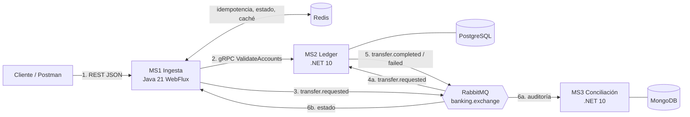
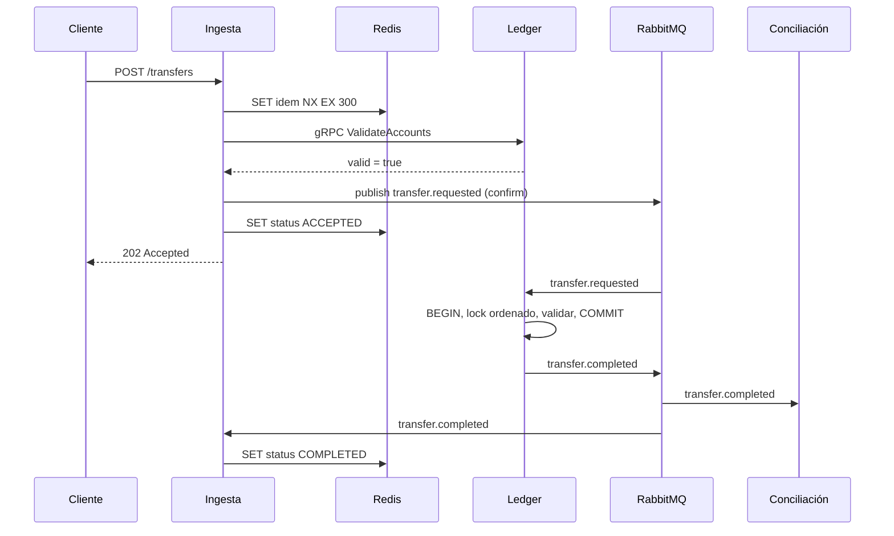

## 0. Control de cambios (v1 → v2)

| #   | Cambio                                                                                                                                                                      | Motivo                                                      | ADR      |
| --- | --------------------------------------------------------------------------------------------------------------------------------------------------------------------------- | ----------------------------------------------------------- | -------- |
| 1   | El MS 3 (Conciliación) es **.NET 10 con driver oficial de MongoDB + `IAsyncEnumerable`**. Se eliminan `Flux<Transaction>`, Spring Data Reactive y `ReactiveMongoRepository` | Eran restos de la idea inicial en Java                      | ADR-0002 |
| 2   | Comunicación interna = **gRPC síncrono (solo validación de cuentas) + RabbitMQ (eventos)**. Se retira "asíncrona y unidireccional"                                          | Contradicción entre §2 y el mapa de interacciones           | ADR-0005 |
| 3   | gRPC con **circuit breaker, deadline y fallback** (caché de cuentas en Redis)                                                                                               | Mantener la resiliencia prometida si el Ledger cae          | ADR-0005 |
| 4   | `SETNX ... EX` → **`SET key value NX EX 300`**                                                                                                                              | `SETNX` no admite expiración                                | ADR-0003 |
| 5   | **Doble barrera de idempotencia**: Redis (Ingesta) + PK del asiento (Ledger)                                                                                                | RabbitMQ es _at-least-once_ y el TTL de Redis expira        | ADR-0003 |
| 6   | **Locking ordenado** de cuentas (`ORDER BY Id ... FOR UPDATE`)                                                                                                              | Evitar deadlocks en transferencias cruzadas A→B / B→A       | ADR-0006 |
| 7   | **Publisher confirms** y limpieza de la llave Redis si falla la publicación                                                                                                 | Evitar llaves `PROCESSING` huérfanas                        | ADR-0004 |
| 8   | **Partida doble**: tabla `LineasAsiento` (D/C)                                                                                                                              | `Σ Débitos == Σ Créditos` era trivial con un solo registro  | ADR-0007 |
| 9   | `docker-compose.yml` corregido (indentación de Postgres, healthchecks, volúmenes, sin `version`)                                                                            | Errores de formato                                          | —        |
| 10  | Nuevo **modelo de lectura de estado** (`GET /transfers/{id}`)                                                                                                               | Con `202 Accepted` el cliente necesita conocer el resultado | ADR-0010 |
| 11  | Topología RabbitMQ explícita con DLX/DLQ y reintentos                                                                                                                       | Faltaba definir fallos de consumo                           | ADR-0009 |
| 12  | Auditoría consume `transfer.completed` **y** `transfer.failed` (el mapa solo mostraba `completed`)                                                                          | Inconsistencia                                              | ADR-0004 |
| 13  | Importes como enteros en la unidad mínima (`amountMinor`) y fechas como instantes en UTC; fecha contable en `America/Lima`                                                  | Evitar divergencias de serialización entre Java y -NET      | ADR-0013 |
| 14  | Spring Boot 3.x -> **Spring Boot 4.1.x**; JDK 21 por toolchain de Gradle                                                                                                    | Spring Boot 3.5 terminó su soporte OSS en junio de 2026     | ADR-0014 |

---

## 1. Objetivos del Sistema

- **Objetivo formativo:** ecosistema de microservicios políglota funcional y local que demuestre dominio de programación reactiva (Java WebFlux), .NET multihilo/async, mensajería distribuida (RabbitMQ), RPC binario (gRPC) y persistencia políglota.
- **Objetivo técnico:** resolver de forma óptima tres problemas críticos de un core financiero:
    1. **Idempotencia distribuida** en la ingesta.
    2. **Consistencia estricta (ACID)** en saldos concurrentes.
    3. **Procesamiento analítico masivo** no bloqueante para reportes.
- **Objetivo de rendimiento:** soportar picos simulados (meta: 1.000 transferencias en 5 s ≈ 200 TPS) en hardware de escritorio (12 hilos, 16 GB RAM), desacoplando mediante colas y memoria RAM.
- **Objetivo profesional:** documentar y defender las decisiones arquitectónicas (ADRs, invariantes, pruebas) como evidencia de criterio de arquitecto.

---

## 2. Características Arquitectónicas Generales

- **Estilo:** microservicios desacoplados y políglotas, basados en eventos (EDA).
- **Comunicación externa:** API REST para ingreso de transferencias, consulta de estado, auditoría y reportes.
- **Comunicación interna:**
    - **RabbitMQ (AMQP):** flujo principal de eventos, asíncrono.
    - **gRPC (HTTP/2 + Protobuf):** _única_ llamada síncrona, Ingesta → Ledger, para validar cuentas (fail-fast).
- **CQRS:** los comandos (escritura rápida) están separados de las consultas (estado, auditoría histórica, analítica).
- **Resiliencia distribuida:**
    - Si el **Ledger** cae, la Ingesta sigue aceptando: el circuit breaker se abre y se usa el _fallback_ (caché de cuentas). El Ledger **revalida siempre** (es la fuente de verdad).
    - Si **MongoDB** o el MS de Conciliación caen, los eventos quedan en la cola `auditing.transfers.queue` sin pérdida.
    - Los mensajes fallidos van a DLQ; nada se descarta.

> [!important] Principio rector El **Ledger es la fuente de verdad**. Todo lo que valide la Ingesta (gRPC o caché) es una optimización para fallar rápido; nunca sustituye la validación del Ledger.

---

## 3. Stack Tecnológico de los Componentes

### Componente 1: Microservicio de Ingesta y Validación

- **Ejecución:** Java 21 / Spring Boot 4.1.x (Spring WebFlux).
- **Paradigma:** programación reactiva (non-blocking I/O, Project Reactor).
- **Diseño interno:** **Arquitectura Hexagonal** (puertos y adaptadores): dominio/aplicación sin dependencias de Spring, Redis, RabbitMQ ni gRPC.
- **Persistencia:** Redis (llaves de idempotencia, estado de transferencias, caché de cuentas).
- **Rol:** puerta de enlace; validación de esquema, idempotencia distribuida, validación gRPC con fallback, publicación a RabbitMQ y modelo de lectura de estado.

### Componente 2: Microservicio del Ledger (Libro Mayor)

- **Ejecución:** .NET 10 (C# 14).
- **Diseño:** Clean/Onion Architecture + CQRS con MediatR.
- **Datos:** PostgreSQL 16 con EF Core (Dapper / SQL explícito para escrituras críticas).
- **Rol:** consumidor de `transfer.requested`, ejecutor de la lógica contable con aislamiento ACID, servidor gRPC de validación de cuentas, publicador de `transfer.completed` / `transfer.failed`.

### Componente 3: Microservicio de Conciliación y Reportes

- **Ejecución:** .NET 10 (C# 14).
- **Datos:** MongoDB con el **driver oficial de .NET** (`MongoDB.Driver`) y `IAsyncEnumerable<T>` para lectura en streaming.
- **Rol:** auditoría append-only, conciliación por lotes (`Σ Débitos == Σ Créditos`), consulta de historial y exportación Excel/PDF.

### Infraestructura común (Docker local)

- **Mensajería:** RabbitMQ.
- **Contenedores:** Docker Compose con límites de RAM/CPU por motor.
- **Contratos:** carpeta `/contracts` (`.proto` y JSON Schema), versionada.

---

## 4. Flujo de Datos y Mensajería Detallada

### Paso 1 — Ingesta e idempotencia (Java WebFlux + Redis)

1. El cliente envía `POST /api/v1/transfers` con un `transactionId` (UUID).
2. El event loop de WebFlux recibe la petición sin bloquear. Se valida el esquema (`400` si es inválido).
3. **Barrera de idempotencia 1** (atómica): `SET idem:{transactionId} PROCESSING NX EX 300`.
    - Respuesta `nil` (la llave existe) → se detiene y se responde `409 Conflict` (o la respuesta previa).
    - Respuesta `OK` → continúa.
4. **Validación gRPC** `ValidateAccounts` al Ledger (deadline corto, circuit breaker):
    - Respuesta negativa → `DEL idem:{id}` y `400 Bad Request`.
    - Circuit abierto / timeout → **fallback**: se consulta la caché `account:{id}` en Redis; si no hay información, se acepta marcada como _no verificada_ (el Ledger decidirá).
5. Pre-validación del saldo estimado contra la caché (solo orientativa).
6. Se serializa el evento y se publica en `banking.exchange` con la routing key `transfer.requested` (mensaje persistente, **publisher confirm** obligatorio).
    - Si falla la publicación → `DEL idem:{id}` y `503 Service Unavailable`.
7. `SET status:{id} ACCEPTED EX 86400` y se retorna `202 Accepted`.

### Paso 2 — Procesamiento del Ledger (.NET 10 + PostgreSQL)

1. Un `BackgroundService` consume `ledger.transfers.queue` (ack manual, `prefetch` configurado).
2. MediatR despacha `ProcessTransferCommand`.
3. **Barrera de idempotencia 2:** si ya existe un asiento con ese `Id` (= `transactionId`), se hace `ack` y se omite (el mensaje era duplicado).
4. Se abre una transacción explícita (`READ COMMITTED` + bloqueo de filas).
5. **Locking ordenado** (siempre en orden ascendente de `Id`, evita deadlocks):

```sql
SELECT "Id", "Saldo", "Estado"
FROM "Cuentas"
WHERE "Id" = ANY(@ids)
ORDER BY "Id"
FOR UPDATE;
```

6. Se valida en el dominio: cuentas existentes y activas, moneda, `Saldo >= Monto`.
    - **Éxito:** se actualizan saldos, se inserta el asiento y sus dos líneas (débito y crédito) y se hace `COMMIT`. Se publica `transfer.completed`.
    - **Fallo:** `ROLLBACK`, se registra el asiento como `REJECTED` con el motivo y se publica `transfer.failed`.
7. `ack` del mensaje original **después** del commit y la publicación confirmada.

> [!warning] Riesgo conocido (R-03) Si el proceso cae entre el `COMMIT` y la publicación del evento, el resultado no se publica. Mitigación planificada: **Transactional Outbox** (ADR-0011, opcional en Sprint 5).

### Paso 3 — Auditoría y cierre contable (.NET 10 + MongoDB)

1. El MS de Conciliación consume `auditing.transfers.queue` (bindings `transfer.completed` y `transfer.failed`).
2. Cada evento se inserta en la colección `transaction_logs` (**append-only**: el usuario de Mongo del servicio solo tiene permisos de `insert` y `find`). Un índice único `(transactionId, estadoFinal)` hace idempotente el consumo.
3. Al cierre (o bajo demanda con `POST /api/v1/reconciliation/run`) se lee la colección en **streaming** con `IAsyncEnumerable<TransactionLog>`.
4. Se agrupa en lotes (paralelismo controlado) y se verifica `Σ Débitos == Σ Créditos` por lote y por corrida; las discrepancias se persisten en `reconciliation_runs`.
5. Se generan Excel y PDF y se guardan localmente.

### Paso 4 — Consulta de estado (modelo de lectura)

1. La Ingesta consume `ingestion.status.queue` (bindings `transfer.completed` y `transfer.failed`) y actualiza `status:{id}` en Redis (`COMPLETED` / `FAILED` + motivo).
2. `GET /api/v1/transfers/{id}` lee directamente de Redis (la Ingesta **nunca** lee PostgreSQL).

---

## 5. Esquemas de Datos y Contratos

### A. Contratos de eventos (JSON Schema en `/contracts/events`)

Cabeceras AMQP obligatorias: `messageId`, `correlationId` (= `transactionId`), `schemaVersion`, `content-type: application/json`, `delivery_mode: 2`.

**`transfer.requested` (v1)**

```json
{
  "transactionId": "f81d4fae-7dec-11d0-a765-00a0c91e6bf6",
  "accountSource": "ACCOUNT-PERU-001",
  "accountDestination": "ACCOUNT-PERU-002",
  "amountMinor": 150050,
  "currency": "PEN",
  "timestamp": "2026-09-30T19:25:00Z",
  "validation": "VERIFIED"
}
```

> `validation` toma `VERIFIED` (gRPC) o `UNVERIFIED` (fallback).

**`transfer.completed` (v1)**

```json
{
  "transactionId": "f81d4fae-7dec-11d0-a765-00a0c91e6bf6",
  "status": "COMPLETED",
  "entries": [
    { "account": "ACCOUNT-PERU-001", "type": "DEBIT",  "amountMinor": 150050 },
    { "account": "ACCOUNT-PERU-002", "type": "CREDIT", "amountMinor": 150050 }
  ],
  "currency": "PEN",
  "processedAt": "2026-09-30T19:25:02Z",
  "processor": "Ledger-NetCore-Instance-1"
}
```

**`transfer.failed` (v1)**

```json
{
  "transactionId": "f81d4fae-7dec-11d0-a765-00a0c91e6bf6",
  "status": "FAILED",
  "reason": "INSUFFICIENT_FUNDS",
  "processedAt": "2026-09-30T19:25:02Z",
  "processor": "Ledger-NetCore-Instance-1"
}
```

Motivos válidos: `INSUFFICIENT_FUNDS`, `ACCOUNT_NOT_FOUND`, `ACCOUNT_INACTIVE`, `CURRENCY_MISMATCH`.

### B. Contrato gRPC (`/contracts/grpc/account_validation.proto`)

```proto
syntax = "proto3";
package coretransact.ledger.v1;

service AccountValidation {
  rpc ValidateAccounts (ValidateAccountsRequest) returns (ValidateAccountsResponse);
}

message ValidateAccountsRequest {
  string account_source = 1;
  string account_destination = 2;
  string currency = 3;
}

message ValidateAccountsResponse {
  bool valid = 1;
  string reason = 2; // vacío si valid = true
}
```

### C. Modelo relacional en PostgreSQL (Ledger)

```sql
CREATE TABLE "Cuentas" (
    "Id"        VARCHAR(50)    PRIMARY KEY,
    "ClienteId" VARCHAR(50)    NOT NULL,
    "Saldo"     BIGINT         NOT NULL CHECK ("Saldo" >= 0),
    "Moneda"    CHAR(3)        NOT NULL,
    "Estado"    VARCHAR(20)    NOT NULL DEFAULT 'ACTIVE',
    "Version"   INT            NOT NULL DEFAULT 0   -- concurrencia optimista (opcional)
);

-- "Id" = transactionId: la PK es la barrera de idempotencia 2
CREATE TABLE "AsientosContables" (
    "Id"            UUID           PRIMARY KEY,
    "Estado"        VARCHAR(20)    NOT NULL,        -- COMPLETED | REJECTED
    "MotivoRechazo" VARCHAR(40),
    "FechaRegistro" TIMESTAMPTZ    NOT NULL DEFAULT CURRENT_TIMESTAMP
);

-- Partida doble: 2 líneas por asiento completado
CREATE TABLE "LineasAsiento" (
    "Id"        BIGSERIAL      PRIMARY KEY,
    "AsientoId" UUID           NOT NULL REFERENCES "AsientosContables" ("Id"),
    "CuentaId"  VARCHAR(50)    NOT NULL REFERENCES "Cuentas" ("Id"),
    "Tipo"      CHAR(1)        NOT NULL CHECK ("Tipo" IN ('D', 'C')),
    "Monto"     BIGINT         NOT NULL CHECK ("Monto" > 0)
);
```

> [!note] Invariante contable Para todo asiento `COMPLETED`: `Σ(Monto donde Tipo='D') == Σ(Monto donde Tipo='C')`. Se verifica en el dominio, en pruebas y en la conciliación.

### D. Esquema documental en MongoDB (Conciliación)

Colección `transaction_logs` (índice único `{ transactionId: 1, estadoFinal: 1 }`):

```json
{
  "_id": "ObjectId",
  "transactionId": "f81d4fae-7dec-11d0-a765-00a0c91e6bf6",
  "schemaVersion": 1,
  "payloadCompleto": { },
  "estadoFinal": "COMPLETED",
  "nodoProcesador": "Ledger-NetCore-Instance-1",
  "fechaAuditoria": "2026-09-30T19:25:02.124Z"
}
```

Colección `reconciliation_runs`: `runId`, `inicio`, `fin`, `totalDebitos`, `totalCreditos`, `lotes`, `discrepancias[]`, `archivos[]`.

### E. Llaves en Redis (Ingesta)

|Llave|Valor|TTL|Uso|
|---|---|---|---|
|`idem:{transactionId}`|`PROCESSING`|300 s|Barrera de idempotencia 1|
|`status:{transactionId}`|`ACCEPTED` / `COMPLETED` / `FAILED`|24 h|Modelo de lectura de estado|
|`account:{accountId}`|estado, moneda, saldo estimado|60 s|Caché y fallback gRPC|

> Redis se configura con `maxmemory-policy noeviction` para no perder llaves de idempotencia por presión de memoria.

---

## 6. Topología de RabbitMQ

- **Exchange:** `banking.exchange` (tipo `topic`, durable).
- **Dead-letter exchange:** `banking.dlx`.

|Cola|Binding(s)|Consumidor|
|---|---|---|
|`ledger.transfers.queue`|`transfer.requested`|Ledger|
|`auditing.transfers.queue`|`transfer.completed`, `transfer.failed`|Conciliación|
|`ingestion.status.queue`|`transfer.completed`, `transfer.failed`|Ingesta (modelo de lectura)|
|`*.dlq` (una por cola)|vía `banking.dlx`|Revisión / reproceso manual|

Reglas: colas durables, mensajes persistentes, publisher confirms, ack manual, `prefetch` explícito, reintentos con cola de espera (TTL) y luego DLQ.

---

## 7. Despliegue local (`docker-compose.yml`)

Levantar todo: `docker compose up -d`. Credenciales **solo para desarrollo**; no se versionan reales (usar `.env`).

```yaml
services:
  redis:
    image: redis:7-alpine
    container_name: coretransact-redis
    command: ["redis-server", "--maxmemory", "256mb", "--maxmemory-policy", "noeviction"]
    ports:
      - "6379:6379"
    healthcheck:
      test: ["CMD", "redis-cli", "ping"]
      interval: 10s
      timeout: 3s
      retries: 5
    deploy:
      resources:
        limits:
          memory: 300M

  rabbitmq:
    image: rabbitmq:3.13-management-alpine
    container_name: coretransact-rabbitmq
    ports:
      - "5672:5672"
      - "15672:15672"   # UI de administración (guest/guest)
    healthcheck:
      test: ["CMD", "rabbitmq-diagnostics", "-q", "ping"]
      interval: 15s
      timeout: 10s
      retries: 5
    deploy:
      resources:
        limits:
          memory: 512M

  postgres:
    image: postgres:16-alpine
    container_name: coretransact-postgres
    environment:
      POSTGRES_USER: ledger_user
      POSTGRES_PASSWORD: ledger_password
      POSTGRES_DB: coretransact_ledger
    ports:
      - "5432:5432"
    volumes:
      - pg_data:/var/lib/postgresql/data
    healthcheck:
      test: ["CMD-SHELL", "pg_isready -U ledger_user -d coretransact_ledger"]
      interval: 10s
      timeout: 5s
      retries: 5
    deploy:
      resources:
        limits:
          memory: 512M

  mongodb:
    image: mongo:7
    container_name: coretransact-mongodb
    environment:
      MONGO_INITDB_ROOT_USERNAME: admin
      MONGO_INITDB_ROOT_PASSWORD: admin_password
    ports:
      - "27017:27017"
    volumes:
      - mongo_data:/data/db
    healthcheck:
      test: ["CMD", "mongosh", "--quiet", "--eval", "db.adminCommand('ping').ok"]
      interval: 15s
      timeout: 10s
      retries: 5
    deploy:
      resources:
        limits:
          memory: 512M

volumes:
  pg_data:
  mongo_data:
```

---

## 8. Mapa General de Interacciones



### Secuencia del camino feliz



### Tipos de comunicación

|Tramo|Tipo|Protocolo|Propósito|
|---|---|---|---|
|Cliente → Ingesta|Síncrono (externo)|HTTP/JSON|Solicitar transferencia, consultar estado|
|Ingesta → Ledger|Síncrono, punto a punto|gRPC / Protobuf (HTTP/2)|Validar cuentas (fail-fast) con fallback|
|Ingesta/Ledger → RabbitMQ → consumidores|Asíncrono, EDA|AMQP|Procesar contabilidad, auditar y actualizar estado|

---

## 9. Casos de Uso

|ID|Caso de uso|Servicio|
|---|---|---|
|CU-01|Solicitar transferencia (esquema, idempotencia, `202`)|Ingesta|
|CU-02|Rechazar transferencia duplicada (`409` / respuesta previa)|Ingesta|
|CU-03|Validar cuentas por gRPC (`400` si no son válidas)|Ingesta → Ledger|
|CU-04|Publicar `transfer.requested` con confirmación|Ingesta|
|CU-05|Procesar transferencia con ACID y locking ordenado|Ledger|
|CU-06|Rechazar por saldo insuficiente y publicar `transfer.failed`|Ledger|
|CU-07|Garantizar idempotencia en el consumo (duplicados)|Ledger|
|CU-08|Registrar eventos en auditoría append-only|Conciliación|
|CU-09|Ejecutar conciliación (manual y programada)|Conciliación|
|CU-10|Exportar reportes Excel/PDF|Conciliación|
|CU-11|Manejar mensajes fallidos (reintentos + DLQ)|Transversal|
|CU-12|Degradación controlada si el Ledger cae|Ingesta|
|CU-13|Prueba de carga y evidencia de resultados|Transversal|
|CU-14|Consultar estado de una transferencia|Ingesta|
|CU-15|Gestionar cuentas semilla (datos de prueba)|Ledger|
|CU-16|Consultar historial de auditoría|Conciliación|

---

## 10. Plan de Implementación

Resumen (el detalle día por día está en el backlog de Jira):

|Sprint|Meta|Prueba de éxito|
|---|---|---|
|S0|Setup, gobernanza, compose corregido|4 contenedores sanos|
|S1|Ingesta + idempotencia|`202` y luego `409` con el mismo `transactionId`|
|S2|RabbitMQ + gRPC|Evento publicado con confirm; validación gRPC con fallback|
|S3|Ledger ACID|Saldos correctos bajo concurrencia; primer flujo E2E|
|S4|Auditoría + conciliación|Historial en Mongo; cuadre de partida doble|
|S5|Resiliencia, reportes, estado, observabilidad|DLQ funcional; el sistema degrada sin Ledger|
|S6|Carga + documentación final|Informe k6; cero saldos corruptos; arc42/C4|

---

## 11. Estrategia de Calidad (resumen)

- **Pruebas:** unitarias (dominio), integración con **Testcontainers**, contract tests (`.proto` / JSON Schema), concurrencia, caos y carga (**k6**).
- **Reactivo:** `StepVerifier`, `WebTestClient`, **BlockHound** (detecta bloqueos en el event loop).
- **Arquitectura ejecutable:** **ArchUnit** (Java) y **NetArchTest** (.NET) hacen cumplir [[Invariantes-Arquitectonicas]].
- **Documentación viva:** ADRs, C4 en Mermaid/Structurizr y arc42 dentro del repo.
